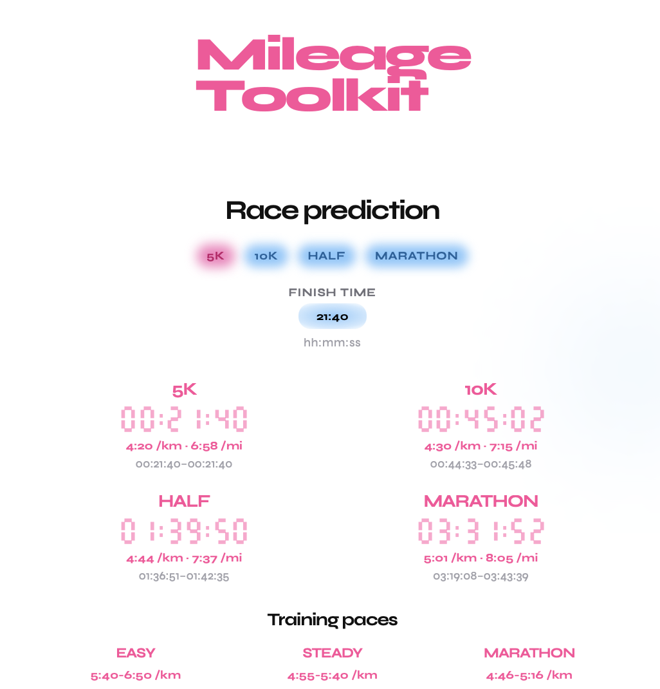
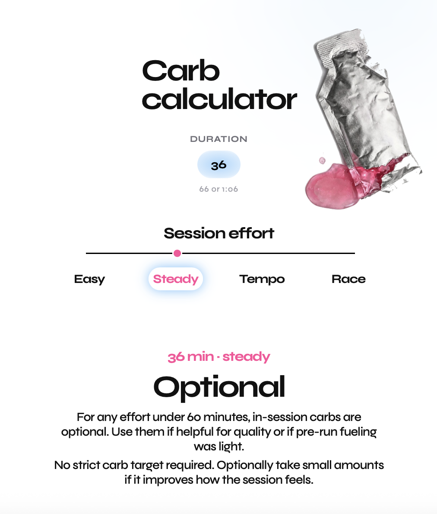

# Mileage Toolkit

> **Live Application:** [mileagetoolkit.com](https://mileagetoolkit.com)

<table border="0">
  <tr>
    <td width="44%" align="center">
      
    </td>
    <td width="30%" align="center">
      
    </td>
  </tr>
</table>

I had already built some tools for my own running in C: race predictions, training paces, fueling, and unit conversions. They worked, but the only way to use them was in the terminal, and I wanted a cleaner front end than that.

Mileage Toolkit is that front end, at [mileagetoolkit.com](https://mileagetoolkit.com). The same kind of tools are on one page, plus a run kit for the weather, which the terminal version never had. I gave coding with AI agents a shot while building it. The agents wrote a lot of the wiring. I kept the product decisions: what a result should mean, which inputs belong on the page, and what the numbers are based on.

## Stack

**Next.js 16 (App Router) and React 19.** The whole tool is one page. Each calculator is a client component, and the result updates from the inputs in the browser. There is no backend and no account. Race times, paces, and fueling are computed in the browser. The run kit is the one part that leaves the page: it asks Open-Meteo for the forecast and a public location lookup for the city. Neither call needs an API key. Next.js still gives me the page shell, the tab icon, and a normal production build I can host.

**TypeScript, with `strict` on.** A finish time, a pace, and a duration are all strings until they are parsed, and after that they are easy to mix up because they are all numbers of seconds. The parsers in `fields.ts` return a result or null, so an unfinished clock like `1:` does not become a one-minute race. The calculator modules export named types (`TrainingPaceZone`, `CarbSessionIntensity`, `KitSession`, `RacePredictionRange`) so a fueling effort cannot be passed where a pace zone or a kit session is expected. I would rather have the compiler catch that than find it by breaking the page.

**One CSS file.** The look is a small system: one typeface, a pink and blue palette, and a layout that changes with the width. I wrote that in `globals.css` instead of utility classes, so the visual rules live in one place. Tailwind is installed because it comes with this Next.js setup. The page does not use it.

**ESLint**, with the Next.js Core Web Vitals and TypeScript configs, so the React and type rules stay on while the page changes.

## How the code is split

The page is only the layout. The math does not import React, so the same functions can run in the browser and in the terminal script.

```text
src/app/page.tsx                 the page
src/app/components/              inputs, clocks, and the four tools
src/app/components/KitPanel.tsx  city, time, session, and the kit result
src/app/utils/race.ts            race-time range
src/app/utils/paces.ts           training paces
src/app/utils/carbs.ts           in-session fueling
src/app/utils/kit.ts             what to wear for a forecast hour
src/app/utils/units.ts           pace, distance, and time conversions
src/app/components/fields.ts     what the text fields accept
scripts/test-running-calculators.ts
```

Race predictions use Peter Riegel's formula at three exponents (1.04, 1.06, and 1.08), plus an equivalent-pace projection with a small fatigue factor. The clock shows the middle of that range, and the range sits underneath it. Weekly volume still exists in `race.ts` for the terminal script. I took it off the page because it made the finish-time form awkward, and the site does not ask for it.

Training paces are not a published system such as Jack Daniels. They start from those same predictions, then use fixed offsets I checked against my own training: easy is deliberately wide and slow, steady meets the fast end of easy, marathon pace is centered on the predicted marathon pace, and 5K intervals are faster than 5K race pace.

Fueling depends on duration and effort (easy, steady, tempo, race). Under 30 minutes, in-session carbs are not needed. From 30 minutes they are optional, and an easy or steady run stays optional a little past an hour. Longer sessions get a grams-per-hour target. Duration accepts a number of minutes (`66`) or hours and minutes (`1:06`).

The run kit starts from the feels-like temperature at the hour you pick, then shifts for the session: an easy run dresses warmer, a tempo or race dresses lighter. Shorts stay the default until it is below freezing. A long sleeve tee is the cold-weather top, around the temperature of a winter easy run, not the suggestion for a mild afternoon. A buff shows up in the cold, and a cap shows up in the rain. Too cold, just right, and too hot are saved in this browser and nudge the next suggestion. The forecast comes from Open-Meteo. "Use my location" uses a city-level lookup, so it does not ask the browser for GPS.

## Run it locally

```bash
npm install
npm run dev
```

Open [http://localhost:3000](http://localhost:3000).

```bash
npm run build    # production build
npm run lint
npm run test:running
```

`test:running` is an interactive terminal version of the same calculators. It still asks for weekly volume, which the website does not.
